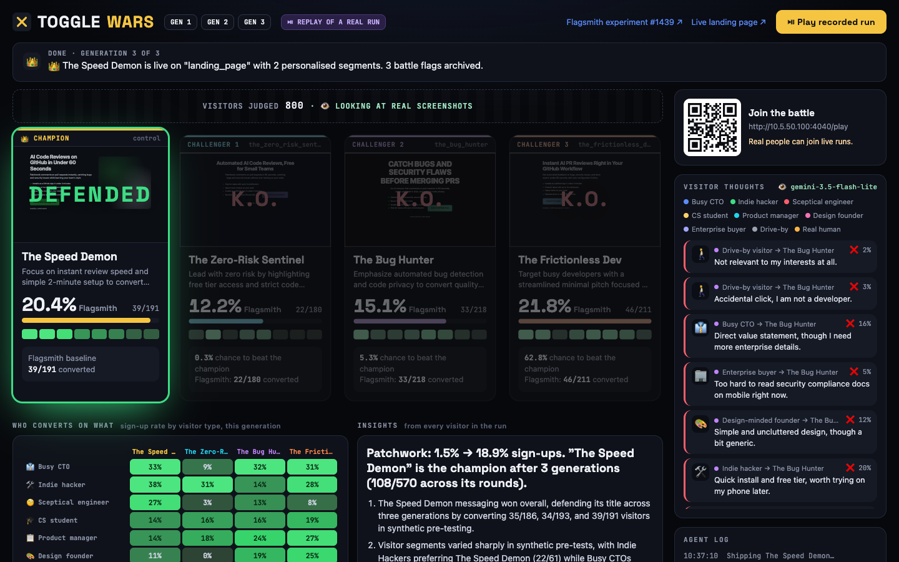
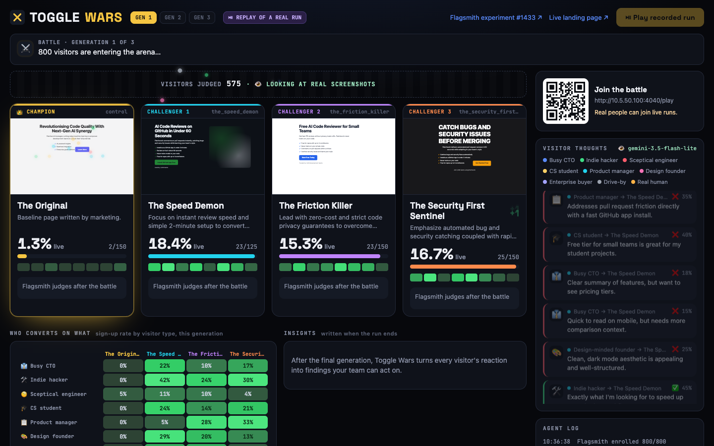
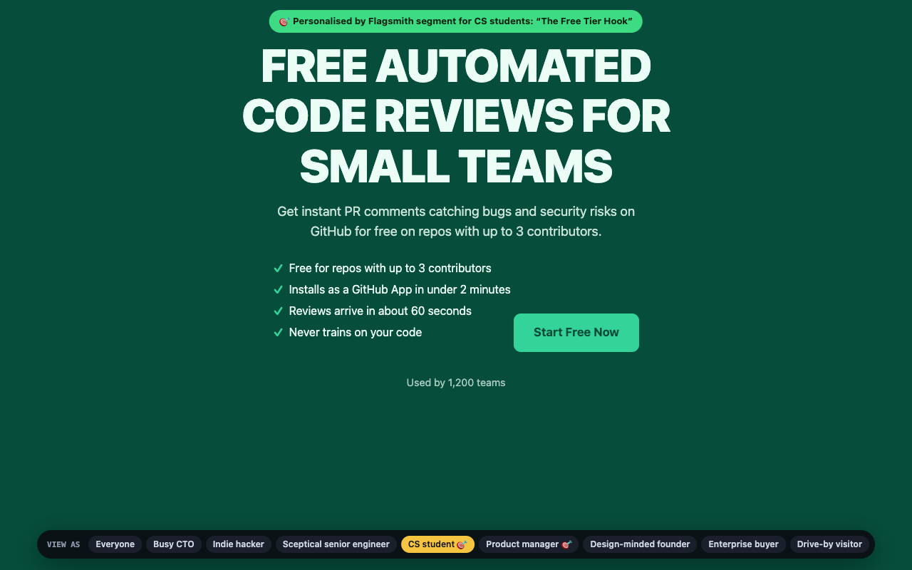

# ⚔️ Toggle Wars

**Your landing page evolves itself, and Flagsmith is the referee.**

An AI agent breeds challenger versions of your page. A crowd of synthetic visitors *looks at real screenshots* of them inside a live **Flagsmith Experiment**, real people can join the same experiment from their phones, Flagsmith's Bayesian engine crowns the winner, and the winner's offspring fight again in the next generation. At the end, the champion ships to production through a feature flag (no deploy), and you get a report on which message works for which kind of visitor.



> Built for the WeMakeDevs × Flagsmith **Toggle Wars** hackathon, Track 02: *AI Agents and Feature Flags*.

### ▶ Watch a real run in two minutes, no API keys needed

```bash
git clone https://github.com/Krishjain52/Toggle-Wars.git && cd Toggle-Wars
npm install
npm run replay          # open http://localhost:4040 and press "Play recorded run"
```

Every live run is recorded event by event. [`runs/demo.jsonl`](runs/demo.jsonl) is a real 3-generation run against Flagsmith Cloud, replayed at 8× speed.

| Mid-battle: 800 visitors judging screenshots | After the run: segment override served by Flagsmith |
|---|---|
|  |  |

**Result of that run:** the original buzzword page converted **1.5%**. Generation 1's *The Speed Demon* took the title at **18.8%** (100% chance to win, by Flagsmith) and defended it in generations 2 and 3. The agent then found two visitor types that clearly preferred a different page and shipped them as Flagsmith segments: CS students → *The Free Tier Hook*, product managers → *The Friction Killer*.

---

## The problem

A/B testing is how good teams improve a product, but each experiment costs hours of setup (flags, variants, metrics, instrumentation) and then weeks of real traffic. So most teams run a handful of tests a year, and often on weak ideas, because coming up with good hypotheses is hard too.

## What Toggle Wars does

One goal ("get more trial sign-ups") becomes a self-running evolution loop, with a human approving every change:

```
       ┌──────────────────────────────── next generation ◀──────────────────────────────┐
       ▼                                                                                 │
 1 BREED            2 APPROVE             3 DEPLOY               4 BATTLE                5 JUDGE
 Gemini designs ─▶  you see previews  ─▶  Flagsmith CLI     ─▶  800 synthetic        ─▶  Flagsmith computes
 3 challengers      + exact CLI           creates flag +        visitors SEE each        chance to win;
 from the champ     commands, approve     experiment            page (screenshot)        winner becomes
 + visitor          in the arena                                + real people via QR     the new champion
 objections                                                                                    │
                                     6 SHIP: champion → `landing_page` flag, battle flags archived
                                     7 LEARN: which message wins with which visitor type
```

| Step | What happens | Flagsmith's role |
|---|---|---|
| **Breed** | Gemini reads the champion, the scoreboard, *why visitors left*, and how each visitor type responded, then writes 3 challengers that each test one explainable idea, using only true product facts. | – |
| **Approve** | The arena shows previews of the challengers and the exact Flagsmith CLI commands about to run. Nothing touches Flagsmith until a human approves (arena button or terminal). | – |
| **Deploy** | The agent drives the official **Flagsmith CLI**: a multivariate flag whose control is the champion and whose keyed variants are the challengers (each page is a JSON flag value, so no redeploy), plus a metric and an experiment. It waits until the experiment has reached Flagsmith's edge before sending traffic. | Flags, variants, metrics, experiments |
| **Battle** | Each synthetic visitor is a Flagsmith identity. `getExperimentFlag` decides which page they get and records the exposure. Gemini role-plays the visitor (busy CTO, sceptical engineer, broke student…) looking at a **real browser screenshot** of exactly that page. Sign-ups go back with `trackEvent`. **Real people** who scan the QR code get a page from the browser SDK in the same experiment. | Bucketing, exposures, conversions (Node + JS SDKs) |
| **Judge** | The agent asks Flagsmith to compute results and reads its Bayesian `chance_to_win`. A challenger needs ≥ 90% to take the title. The experiment is completed with Flagsmith's rollout decision. | Bayesian inference, SRM check, rollout decision |
| **Ship** | After approval, the champion is written to the `landing_page` flag. [`/live`](http://localhost:4040/live) reads it on every request, so the real page changes instantly. Battle flags are archived, so every experiment stays browsable. | Flag update, archive |
| **Learn** | A persona × page matrix from every visitor, turned into findings like "privacy claims convert sceptical engineers best". | – |

## Why synthetic visitors?

They are a **pre-test, not a replacement for users**. Real traffic is precious: you don't want to spend two weeks of it on a headline a sceptical engineer would reject in two seconds. Toggle Wars weeds out weak ideas in minutes, and the survivors run against real users through the *same* flags and experiments with no code changes. The QR code proves the point live: real people and synthetic visitors land in one Flagsmith experiment, side by side.

## Statistics and fairness

- **Flagsmith decides.** Winners come from the Bayesian results Flagsmith computes for each experiment (`chance_to_win`, lift, credible interval, sample ratio mismatch check).
- **One documented gap is filled, and labelled.** Flagsmith only reports inference when *both* arms have ≥ 50 identities and ≥ 5 conversions. A weak champion often converts fewer than 5 visitors, which leaves every challenger without a verdict exactly when the answer is most obvious (e.g. 2/114 vs 15/95). Only in that case, Toggle Wars runs a two-proportion test on **Flagsmith's own counts** and marks the result `FALLBACK` in the arena. See [`src/stats.ts`](src/stats.ts).
- **Visitors see, not just read.** Each page is rendered in a real browser (your installed Chrome via `puppeteer-core`) and the screenshot goes to the model, so design, contrast and hierarchy matter. Without Chrome it falls back to text, and the arena says so.
- **Same judge for every fighter.** One Gemini model judges every visitor in a generation, so no page is scored by a more generous model.
- **Realistic and reproducible.** Visitors return a calibrated *likelihood* of signing up (most pages convert 2–15%), and a seeded draw makes the decision. The same `SEED` replays the same crowd.
- **Noise is real.** Each generation sees a fresh crowd of ~200 visitors per page, so the same page can score differently between rounds, just like real A/B tests. That's why the bar to dethrone a champion is high.

## How Flagsmith is used

| Flagsmith feature | Where | What it does |
|---|---|---|
| Multivariate flags with JSON values | [`src/flagsmith/admin.ts`](src/flagsmith/admin.ts) | Each page is a flag value; variants go live with no deploy |
| Flagsmith CLI (`feature create`, `variant add`, `flag update`, `feature update --archive`, `api`) | [`src/flagsmith/admin.ts`](src/flagsmith/admin.ts) | Every admin change is an auditable CLI command, shown to the human before it runs |
| Experimentation API (metrics, experiments, start, results refresh, complete with rollout decision) | [`src/flagsmith/admin.ts`](src/flagsmith/admin.ts) | One experiment per generation |
| Node SDK `getExperimentFlag` + `trackEvent` | [`src/swarm.ts`](src/swarm.ts) | Buckets synthetic visitors, records exposures and conversions |
| **Browser SDK** `getExperimentFlag` + `trackEvent` | [`src/arena/play.html`](src/arena/play.html) | Real people join the same experiment from their phones |
| Bayesian results (`chance_to_win`, lift, SRM) | [`src/evolve.ts`](src/evolve.ts) | Decides every round |
| Environment flags at request time | [`src/arena/server.ts`](src/arena/server.ts) | `/live` renders whatever `landing_page` holds right now |

## Run it live

**Requirements:** Node 20+, a free [Flagsmith](https://app.flagsmith.com) account, a free [Gemini API key](https://aistudio.google.com/apikey), and (optional, for screenshot judging) Google Chrome.

```bash
npm install
cp .env.example .env        # then fill in the keys below
```

1. In Flagsmith, create an **Organisation API key** (Organisation settings → API Keys) and put it in `FLAGSMITH_API_KEY`.
2. Create a project and environment (or with the CLI: `npx flagsmith project create "Toggle Wars"`), then bind this folder to it:
   ```bash
   npx flagsmith init --project <project id> --environment <client-side environment key>
   ```
   Put the same client-side key in `FLAGSMITH_ENVIRONMENT_KEY`.
3. Make sure the environment has a warehouse (Environment settings → Warehouse → *Flagsmith database*).
4. Put your Gemini key in `GEMINI_API_KEY`.

```bash
npm run arena
```

Open **http://localhost:4040** and press **Start evolution**. Approve each generation as it's proposed. Real people on the same Wi-Fi can scan the QR code to join (set `PUBLIC_URL` if you expose the server another way). The live landing page is at **http://localhost:4040/live**.

A 3-generation run takes about 15–25 minutes: Flagsmith ingests events within about a minute and allows a results refresh every 5 minutes, and Gemini's free tier is sometimes busy (the agent waits and retries rather than failing).

### Configuration

| Variable | Default | Meaning |
|---|---|---|
| `GENERATIONS` | `3` | Rounds of evolution |
| `CHALLENGERS` | `3` | Challengers per round (plus the champion) |
| `VISITORS_PER_GENERATION` | `800` | Synthetic visitors per round (Flagsmith needs ≥ 50 per variant) |
| `WIN_THRESHOLD` | `0.9` | Chance to win a challenger needs to dethrone the champion |
| `DESIGNER_MODELS` / `VISITOR_MODELS` | Gemini 3.x fallback chains | Which models design pages and play visitors |
| `VISION` | auto | `0` to judge text only; `CHROME_PATH` to point at a browser |
| `SEED` | `1` | Reproducible visitor crowd and decisions |
| `AUTO_APPROVE` | unset | `1` skips approvals (unattended runs only, logged loudly) |
| `PUBLIC_URL` | LAN address | Join link shown in the QR code |
| `FLAGSMITH_SDK_API_URL`, `FLAGSMITH_EVENTS_URL`, `FLAGSMITH_DASHBOARD_URL` | Flagsmith Cloud | Point at a self-hosted Flagsmith |

### Commands

| Command | What it does |
|---|---|
| `npm run arena` | Live arena against Flagsmith + Gemini |
| `npm run replay [file]` | Replay a recorded run (default `runs/demo.jsonl`), no keys needed |
| `npm run doctor` | Check which Gemini models are responding |
| `npm run ship "<fighter>"` | Recovery: ship a named fighter from any run's flags to `landing_page` |

## Use it on your own product

Edit [`src/seed.ts`](src/seed.ts): describe your product, list the facts the designer may use, and write your current page as the generation-0 champion. Edit [`src/personas.ts`](src/personas.ts) to describe your real audience. Everything else stays the same.

## Project layout

```
src/
  arena/server.ts     web server: arena over Server-Sent Events, approvals, /play, /live, replay
  arena/arena.html    the arena screen
  arena/play.html     the page real people land on (Flagsmith browser SDK)
  evolve.ts           the agent loop: breed → approve → deploy → battle → judge → ship → learn
  designer.ts         Gemini challenger designer (learns from objections and segments)
  judge.ts            Gemini visitor simulation from screenshots, batched and calibrated
  swarm.ts            runs visitors through the live Flagsmith experiment
  vision.ts           renders pages in a real browser for screenshot judging
  insights.ts         persona × page matrix and findings
  stats.ts            fallback inference when Flagsmith withholds results
  bus.ts              event-sourced state: one reducer for live, recording and replay
  replay.ts           plays recorded runs
  flagsmith/admin.ts  Flagsmith CLI + Experimentation API
  flagsmith/sdk.ts    Flagsmith Node SDK: exposures and conversions
  personas.ts         visitor archetypes, seeded
  variant.ts          page spec schema and renderer
  seed.ts             demo product and the generation-0 page
  approval.ts         human-in-the-loop gate
  tools/              diagnostics and recovery
```

## Cost

$0. Flagsmith's free plan, Gemini's free tier, and open-source libraries. A run makes about 60 Gemini calls.

## License

MIT
